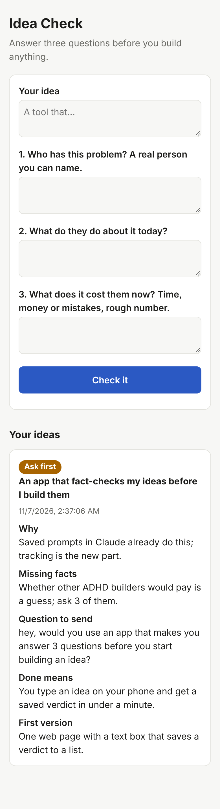

# Idea Check

Fact-check an idea before you build it.

You type an idea and answer three questions:

1. Who has this problem? A real person you can name.
2. What do they do about it today?
3. What does it cost them now: time, money or mistakes?

An AI model gives back a verdict (**Build**, **Ask first** or **Skip**), the facts you're missing, a short message you can send to get them, what "done" means, and the smallest first version you could build in a day. Every check is saved, so all your ideas live in one list.



## Run it

Needs Python 3.10+ and nothing else (standard library only).

```bash
python -m idea_check.server            # http://localhost:8098
python -m idea_check.server --port 9000 --db ~/ideas.db
```

It talks to any OpenAI-compatible chat endpoint, such as a local model served by llama.cpp, vLLM or Ollama:

| Variable | Default | What it is |
|---|---|---|
| `IDEA_CHECK_LLM_URL` | `http://localhost:8080/v1` | Base URL of the endpoint |
| `IDEA_CHECK_LLM_MODEL` | `local` | Model name to send |
| `IDEA_CHECK_LLM_KEY` | *(empty)* | API key, if the endpoint needs one |

## Test

```bash
python -m unittest discover -s tests -t .
```

## Next up

- Reminders to get the missing fact before you start building
- Mark an idea as asked / answered / built
- Re-check an idea when you learn a new fact
